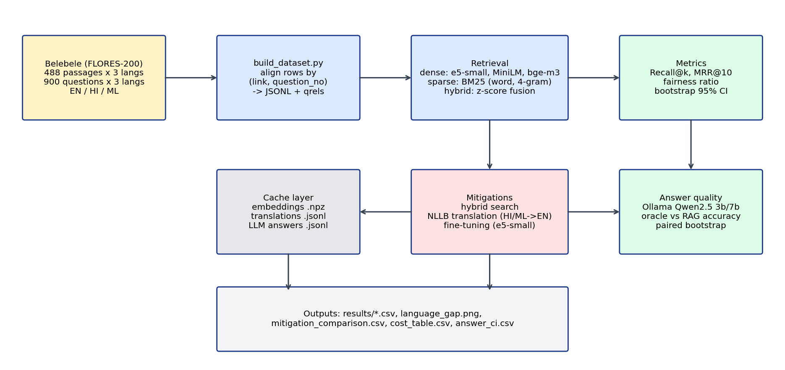

# Multilingual Retrieval Fairness (EN / HI / ML)

Compares embedding models, hybrid search, translation and fine-tuning on a
parallel Belebele (FLORES-200 passages) set. 488 passages, 900 questions per language.

## Run order
1. python src/build_dataset.py
2. python src/baseline.py e5-small minilm bge-m3
3. python src/gap_analysis.py
4. python src/bootstrap_ci.py e5-small ; python src/bootstrap_ci.py bge-m3
5. python src/rag_quality.py qwen2.5:3b 100   (and qwen2.5:7b)
6. python src/hybrid.py
7. python src/translate.py {hi|ml} {queries|corpus} ; python src/translate_options.py
8. python src/translate_eval.py e5-small ; python src/translate_eval.py bge-m3
9. python src/rag_translated.py qwen2.5:3b   (and qwen2.5:7b)
10. python src/finetune.py
11. python src/final_tables.py ; python src/answer_ci.py

## Results
See results/*.csv and results/language_gap.png.

## Notes
- Dataset substituted for the suggested sets: Belebele gives parallel passages, questions and relevance labels.
- Raw Belebele rows are not aligned across languages; they are joined on (link, question_number).
- Early hybrid results used a broken tokenizer (\w+ splits Indic words); fixed and rerun.
- Hardware: CPU only. Malayalam corpus translation time in the log is inflated by a laptop suspend.

## Deliverables
- Technical report: docs/Multilingual_Retrieval_Fairness_Report.docx
- Results notebook: notebooks/results.ipynb
- Data card: DATA_CARD.md
- Architecture diagram: docs/architecture.png
- Demo script: src/run_demo.sh (reads saved results; runs in seconds)
- Demo video: PASTE_LINK_HERE
